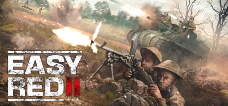

**Easy Red 2 by Marco Amadei is an indie World War II shooter covering multiple theaters including D-Day, North Africa, and the Pacific.**

---

## 📖 About

Easy Red 2 by Marco Amadei is an indie World War II shooter covering multiple theaters including D-Day, North Africa, and the Pacific. It simulates period-accurate tactics, aiming, and unit coordination in massive battles with hundreds of AI soldiers.

## ⚠️ Problems Without Trainer

| Problem | Status |
|---------|--------|
| Bullet simulation means hits from concealed enemies are nearly impossible to locate | ✅ Solved |
| Objective capture requires eliminating all defenders without reinforcement gap | ✅ Solved |
| Aiming accuracy degrades from stamina making extended engagements chaotic | ✅ Solved |
| Friendly AI pathfinding fails in fortified positions removing fire support | ✅ Solved |
| Respawn distances on large maps require 3-minute walks to re-engage objectives | ✅ Solved |

## ✅ Solution

The **Easy Red 2 Trainer** solves all these issues, giving you complete control so you can focus on enjoying the game.

## 🎯 Features

- Unlimited Resources / Currency
- God Mode / Invincibility
- Instant Skill & Ability Cooldown
- One-Hit Kill
- Freeze Timers
- Unlock All Items & Achievements
- Custom Speed Multiplier
- Infinite Stamina / Energy

## 🚀 Quick Start

1. **Disable Windows Defender** temporarily (trainer may trigger false positive)
2. Get the trainer from the button above
3. Launch Easy Red 2
4. Run the trainer as Administrator
5. Use the hotkeys to activate cheats in-game

## 💎 Free vs Pro

| Feature | Free | Pro |
|---------|------|-----|
| God Mode | ✅ | ✅ |
| Unlimited Resources | ✅ | ✅ |
| Advanced Cheats | ❌ | ✅ |
| Auto-Updates | ❌ | ✅ |
| Priority Support | ❌ | ✅ |

## 💻 Requirements

- Windows 10 / 11 (64-bit)
- Easy Red 2 (any version)
- .NET Framework 4.8+
- DirectX 11+

## 🍎 macOS

## ⚖️ Legal

Educational and single-player use only.

---

